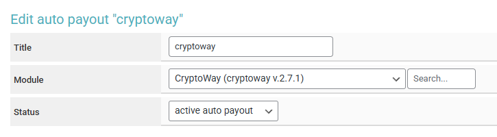
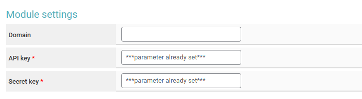
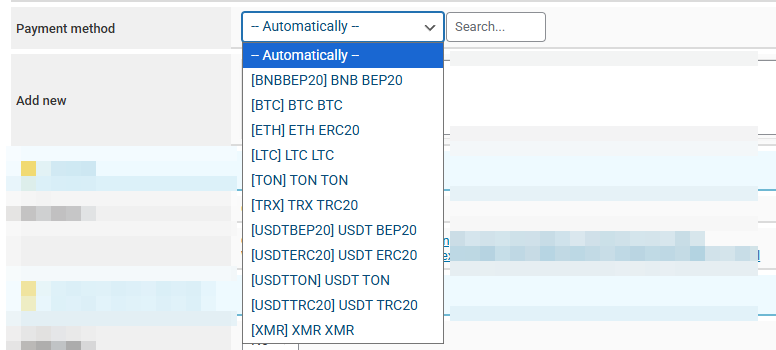

# Cryptoway


<mark style="color:red;">Before setting up auto payouts, please read the</mark> [<mark style="color:blue;">risk warning!</mark>](https://premium.gitbook.io/main/en/basic-settings/merchants-and-auto-payments/auto-payments/risk-warning)



If you need to update the module on the server, please refer to the [instructions](https://premium.gitbook.io/main/en/en/basic-settings/faq/updating-script-files-on-the-server/how-to-update-files-on-the-server#merchant-and-auto-payout-modules).


## Merchant Account Settings


**Disclaimer**: When connecting your website to any service, please assess the potential risks of collaboration on your own.


Register on the [Cryptoway service](https://cryptoway.com/en) and log into your account.

Create a project in the [“Projects”](https://account.cryptoway.com/projects) section of the service.

<figure><figcaption></figcaption></figure>

Go to your project ➔ “API Keys”&#x20;

<figure><figcaption></figcaption></figure>

Copy the callback key and secret key to the clipboard or into notepad.&#x20;

<figure><figcaption></figcaption></figure>

## Module settings

In the admin panel, create a new merchant in the "**Merchants**" ➔ "**Add Auto Payout**" section.

Select **Cryptoway** from the dropdown menu in the "**Module**" field, enter a name for the module, and click "**Save**."

<figure><figcaption></figcaption></figure>

Fill in the required authorization fields.

<figure><figcaption></figcaption></figure>

**Domain —** do not fill in this field, leave it empty.

**API key —** The callback key copied earlier in the Cryptoway user account.

**Secret key —** Key Secret that was previously copied to the Cryptoway account dashboard.

## Special Fields

**Payment method** — select from the dropdown list the currency you will be paying out (selecting "**Automatically**" will use the XML currency code of the "**Receive**" currency).

* **Add** **new** — to add your own currency code.

<figure><figcaption></figcaption></figure>

**Cron file —** [create a task](https://premium.gitbook.io/main/en/basic-settings/faq/how-to-create-a-cron-job-on-a-server) with this link on the server.

## Continuing the Setup

Additional module settings are performed according to the [general setup instructions](https://premium.gitbook.io/main/en/basic-settings/merchants-and-auto-payments/merchants/general-merchant-settings).
