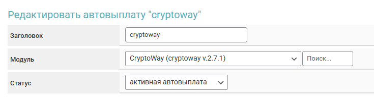
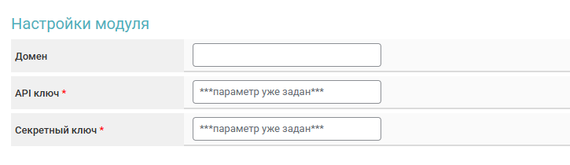
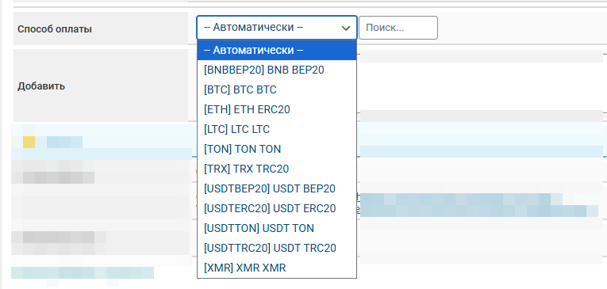

# Cryptoway


<mark style="color:red;">Перед настройкой автовыплат обязательно прочитайте</mark> [<mark style="color:red;">предупреждение о рисках!</mark>](https://premium.gitbook.io/main/osnovnye-nastroiki/merchanty-i-avtovyplaty/avtovyplaty/preduprezhdenie-o-riskakh)



Если вам необходимо обновить модуль на сервере — воспользуйтесь [инструкцией](https://premium.gitbook.io/main/osnovnye-nastroiki/faq/obnovlenie-failov-skripta-na-servere/kak-obnovit-faily-na-servere#moduli-merchantov-i-avtovyplat)


## Настройки в личном кабинете мерчанта


**Дисклеймер**: при подключении вашего сайта к тому или иному сервису, пожалуйста, самостоятельно оценивайте возможные риски сотрудничества.


Зарегистрируйтесь на [сервисе Cryptoway](https://cryptoway.com/ru) и авторизуйтесь в личном кабинете.

Создайте проект в разделе сервиса ["Проекты"](https://account.cryptoway.com/ru/projects).

<figure><figcaption></figcaption></figure>

Перейдите в ваш проект ➔ "API ключи"&#x20;

<figure><figcaption></figcaption></figure>

Скопируйте ID проекта и секретный ключ в буфер обмена или блокнот.&#x20;

<figure><figcaption></figcaption></figure>

## Настройки модуля

В панели администратора создайте нового мерчанта в разделе "**Мерчанты**" ➔ "**Добавить автовыплату".**

Выберите модуль **Cryptoway** в выпадающем списке в поле "**Модуль**", укажите название для модуля и нажмите "**Сохранить**".

<figure><figcaption></figcaption></figure>

Заполните указанные авторизационные поля.

<figure><figcaption></figcaption></figure>

**Домен** — не заполняйте поле, оставьте его пустым.

**API ключ** — ID проекта, скопированный ранее в ЛК Cryptoway.

**Секретный ключ** — секретный ключ,скопированный ранее в ЛК Cryptoway.

## Особые поля

Способ оплаты — выберите из выпадающего списка валюту, которую будете выплачивать (при выборе пункта "**Автоматически**" будет использоваться XML код валюты "**Получаю**")

* **добавить** — добавление своего кода валюты

<figure><figcaption></figcaption></figure>

**Cron-файл -** [создайте задание](https://premium.gitbook.io/main/osnovnye-nastroiki/faq/kak-sozdat-zadanie-cron-na-servere) с такой ссылкой на сервер&#x435;**.**

## Продолжение настройки

Дополнительные настройки модуля выполняются согласно [общей инструкции по настройке](https://premium.gitbook.io/rukovodstvo-polzovatelya/osnovnye-nastroiki/merchanty-i-avtovyplaty/merchanty/obshie-nastroiki-merchantov).
